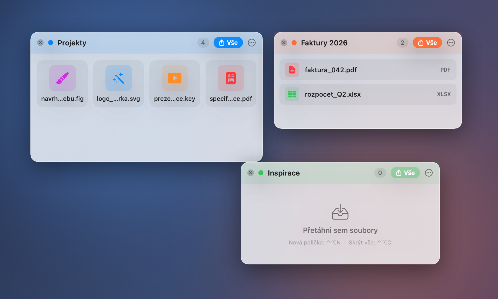
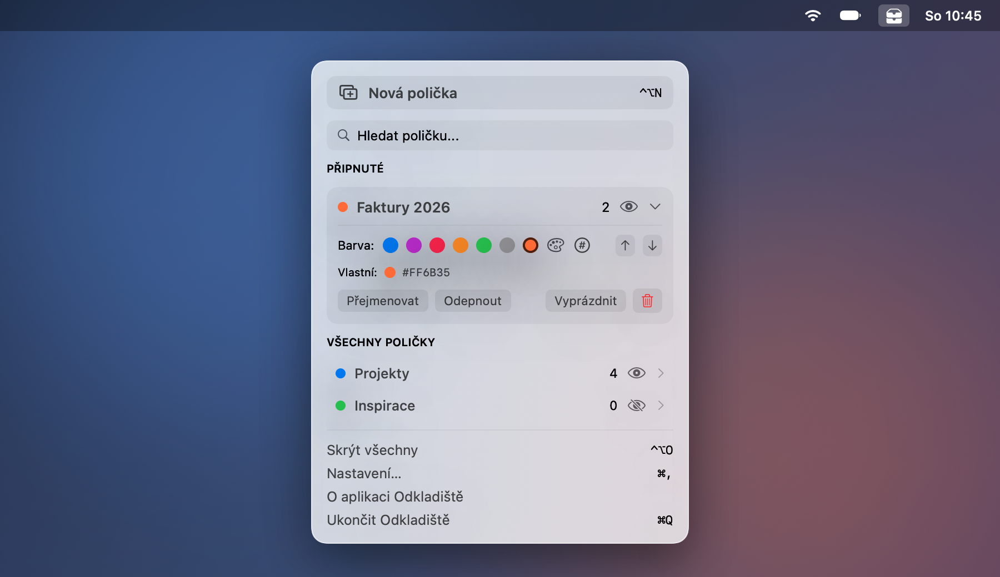
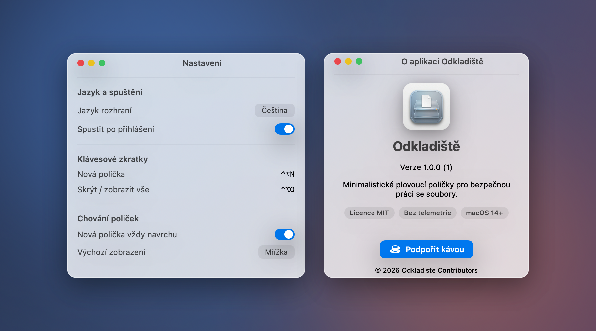

# Odkladiště

Minimalistická nativní macOS aplikace pro dočasné odkládání souborů mezi okny, aplikacemi a monitory. Zásadním principem je **více samostatných plovoucích poliček**, nikoli jediné společné okno.

> **Open-source referenční projekt:** Vytvořeno v jazyce Swift (AppKit + SwiftUI) bez externích závislostí, bez analytiky, bez účtů a bez síťových přenosů.
>
> 🌐 **Produktová stránka:** [zyxlit.github.io/odkladiste](https://zyxlit.github.io/odkladiste/)



<details>
<summary>Další náhledy (Menu bar popover, Nastavení a O aplikaci)</summary>





</details>

---

## Hlavní funkce (verze 1.0)

- **Více nezávislých poliček:** Každá polička má vlastní plovoucí okno (`NSPanel`), název, barvu, připnutí do menu baru, velikost a pozici.
- **Bezpečná práce se soubory:** Přidáním na poličku se soubory nekopírují — ukládá se pouze reference a URL bookmark. Ruční odebrání, vyprázdnění ani smazání poličky **nikdy nemaže původní soubory**.
- **Výdej do jiných aplikací (Finder, Mail a další):**
  - Podporuje kopírování i přesun originálů (`Option` vynutí kopii).
  - Transakční sledování po položkách (`TransferOperation`) — po potvrzeném předání se předané položky automaticky odeberou a prázdná polička zůstane připravená.
  - Samostatný barevný úchyt **„Vše“** pro předání celé poličky najednou.
- **Přetahování mezi poličkami:** Výchozí akcí je přesun reference do cílové poličky (`Option` vytvoří kopii reference v obou poličkách).
- **Menu bar popover:** Rychlá správa všech poliček, změna barev, připnutí a vyhledávání bez zavírání nabídky po každém kliknutí.
- **Kompaktní mřížka a seznam:** Asynchronní Quick Look náhledy s nastavitelnou velikostí (*Malé / Střední / Velké*) a rozlišením stejnojmenných souborů podle rodičovské složky.
- **Výběr, Quick Look, hledání a Zpět:** `klik`, `Cmd+klik`, `Shift+klik`, `Cmd+A`, `Mezerník` (Quick Look), `Cmd+F` (filtrování), `Cmd+Z` / `Shift+Cmd+Z` (Zpět/Znovu).
- **Více monitorů a obnova po restartu:** Atomické ukládání stavu do `Application Support/Odkladiste/state.json` se zálohou a automatické oříznutí oken při odpojení externího monitoru.

---

## Klávesové zkratky

### Globální zkratky
| Zkratka | Akce |
|---|---|
| `Ctrl + Option + N` | Vytvořit novou poličku poblíž kurzoru |
| `Ctrl + Option + O` | Skrýt / znovu zobrazit všechny viditelné poličky |

### Uvnitř aktivní poličky
| Zkratka | Akce |
|---|---|
| `Mezerník` | Rychlý náhled (Quick Look) vybraných souborů |
| `Cmd + A` | Vybrat všechny viditelné položky |
| `Cmd + F` | Otevřít / zavřít lokální filtrování |
| `Cmd + Z` / `Shift + Cmd + Z` | Zpět / Znovu |
| `Delete` / `Backspace` | Odebrat vybrané odkazy z poličky |
| `Cmd + W` | Skrýt poličku |
| `Escape` | Zavřít filtr / zrušit výběr |

---

## Požadavky a instalace (krok za krokem)

- **macOS 14.0+** (Sonoma a novější), Apple Silicon (`arm64`).
- **Swift 6.1+** (stačí lehké Command Line Tools, není potřeba celý Xcode).

### 1. Jednorázová příprava (pokud na Macu nemáš vývojářské nástroje)
Otevři **Terminál** a nainstaluj Command Line Tools od Applu:
```bash
xcode-select --install
```

### 2. Stažení, sestavení a spuštění
1. Stáhni repozitář z GitHubu (přes **Code → Download ZIP** a rozbal, nebo přes `git clone`):
   ```bash
   git clone https://github.com/zyxlit/odkladiste.git
   cd odkladiste
   ```
2. Sestav aplikaci:
   ```bash
   ./scripts/build-app.sh
   ```
   Skript sestaví release binárku přes Swift Package Manager, zabalí ji do `build/Odkladiste.app` a podepíše ad-hoc podpisem pro lokální spuštění.
3. Zkopíruj aplikaci do **Aplikací** a spusť ji:
   ```bash
   cp -R build/Odkladiste.app /Applications/
   open /Applications/Odkladiste.app
   ```
   Aplikace se objeví jako ikona v horní liště (menu baru) a otevře první poličku. V **Nastavení → Obecné** si můžeš zapnout i spouštění po přihlášení a přepnout jazyk (**Čeština / English**).

### 3. Aktualizace na novou verzi
1. V horní liště klikni na **Ukončit Odkladiště**.
2. Ve složce s projektem stáhni novou verzi (`git pull` nebo nový ZIP), znovu ji sestav a přepiš původní aplikaci v `/Applications`:
   ```bash
   git pull
   ./scripts/build-app.sh
   rm -rf /Applications/Odkladiste.app
   cp -R build/Odkladiste.app /Applications/
   open /Applications/Odkladiste.app
   ```
   > **Data zůstanou zachována:** Všechny uložené poličky, barvy, pozice i odkazy na soubory jsou uložené odděleně v `~/Library/Application Support/Odkladiste/state.json`, takže se po aktualizaci automaticky načtou zpět.

### Spuštění unit testů
```bash
swift test
```

*(Poznámka: Testy používají `Swift Testing`, takže běží i bez plného Xcode pouze s Command Line Tools.)*

---

## Dokumentace

- [Architektura, datový formát a oprávnění](docs/ARCHITEKTURA_A_DATA.md)
- [Testovací protokol](docs/TESTOVACI_PROTOKOL.md)
- [Známé limity a backlog P2](docs/ZNAME_LIMITY_A_P2.md)
- [Protokol Etapy A](docs/ETAPA_A_PROTOTYP.md)

---

## Podpora a licence

Pokud ti Odkladiště šetří čas, můžeš vývoj podpořit na [Buy Me a Coffee](https://buymeacoffee.com/cameklibor).

Zdrojový kód je zveřejněn pod licencí **MIT** — viz [LICENSE](LICENSE).
